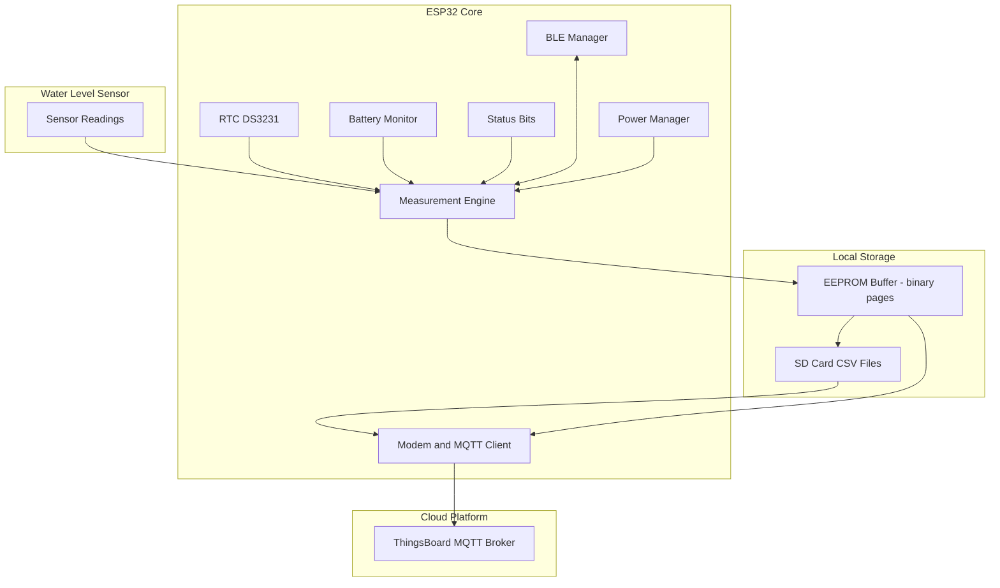
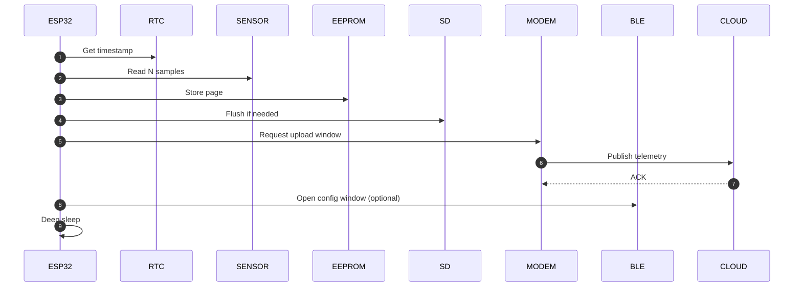

# Architecture & System Design

This document explains the complete architecture of the **LilyGO A7670SA Water Level Telemetry System**, including module interactions, data flow, storage design, BLE commands, and MQTT synchronization.

---

# 1. High-Level System Overview

The device is designed for **autonomous, low‑power, offline‑resilient water level monitoring**.

It performs:

1. **Periodic measurement**  
2. **Local storage to EEPROM**  
3. **Batch flushing to SD (CSV)**  
4. **MQTT sync to ThingsBoard**  
5. **Remote configuration via BLE**  
6. **Deep sleep for power saving**
7. **Solar charging**

---

# 2. System Architecture Diagram



---

# 3. Module Responsibilities

Below is the detailed breakdown of every `.cpp` / `.h` module in the project.

---

## 3.1 `measurement_storage.cpp` / `.h`

🔹 **Core of the data pipeline**  
Handles:

- Sensor sampling  
- Battery & temperature acquisition  
- RTC timestamping  
- EEPROM page creation  
- SD flushing  
- CSV → JSON conversion  
- MQTT publishing  

### Key functions
- `takeMeasurement()`  
- `writeToEEProm()`  
- `dumpEEPROM()`  
- `sendSDPendingToThingsboard()`  
- `csvLineToJson()`  
- `markLineSent()`  

### EEPROM page format (32 bytes)
```
0–3     = seconds since 2000
4–13    = water level samples (int16)
14–15   = battery (mV)
16–17   = temperature (°C x100)
18–21   = status flags (uint32)
31      = sent flag (0/1)
```

---

## 3.2 `eeprom_i2c.cpp` / `.h`

🔹 **Low‑level EEPROM driver**

Provides:

- Page writes (32 bytes)
- Byte read/write
- Buffer reads
- Header reset (bitmap of used pages)

The EEPROM acts as a **short-term ring buffer**, minimizing SD writes.

---

## 3.3 `ble_manager.cpp` / `.h`

🔹 **Bluetooth Low Energy configuration interface**

Implements:

- BLE GATT server
- Read/Write characteristic
- Command parser:
  - `T-<measure>-<ble>-<gprs>`
  - `D-YYYY-MM-DD-HH-MM-SS`
  - `SEND` / `STOP`
- Live streaming of sensor readings
- BLE window timeout logic

BLE is **only on when needed** to save battery.

---

## 3.4 `modem_mqtt.cpp` / `.h`

🔹 **SIM7670 modem power management + MQTT client**

Responsible for:

- Initializing modem  
- Configuring APN  
- Connecting to mobile network  
- Establishing MQTT session  
- Publishing telemetry packets  

Works with both **non‑TLS port 1883** or **TLS 8883** depending on settings.

---

## 3.5 `rtc_utils.cpp` / `.h`

🔹 **RTC helper functions**

Main features:

- Fetch current timestamp  
- Format timestamps (used in CSV)  
- Provide seconds since 2000 (EEPROM format)  
- Read RTC temperature  

Also checks for invalid RTC state on boot.

---

## 3.6 `power_sleep.cpp` / `.h`

🔹 **Low‑power logic**

Manages:

- Turning peripherals on/off (sensor, modem, BLE)
- Selecting next wake-up interval
- Entering deep sleep

The system sleeps between:

- Measurement window  
- BLE window  
- GPRS/MQTT sync window  

---

## 3.7 `error_sensor.cpp` / `.h`

🔹 **Error reporting + ISR handler**

Includes:

- `error(code, led_pin)` → LED pattern for fatal errors  
- `InterruptServiceRoutine()` for GPIO events  

Used for debugging and sensor wake-up events.

---

## 3.8 `utilities.h`

Contains:

- Pin definitions  
- Global structs  
- Status bit constants  
- EEPROM sizes  
- Shared configuration (`ModuleConfig`)  
- Telemetry payload struct  

It acts as the **shared backbone** for all modules.

---

# 4. Data Flow Summary

### 4.1 Measurement Cycle

```
wake → init → sensor ON → read samples → battery/temperature →
pack telemetry → write EEPROM page → sleep
```

### 4.2 Flush Cycle (SD)

Triggered when EEPROM write count reaches `EEPROM_FLUSH_AFTER`.

```
EEPROM pages → CSV lines in YYYYMMDD_P.CSV
```

### 4.3 Upload Cycle (MQTT)

```
CSV lines → JSON payloads → MQTT publish → mark sent → rename file
```

### 4.4 BLE Configuration

```
BLE window open → user sends command → config update → save config → close BLE
```

---

# 5. Status Bit System

Status bits act as a compact health indicator.

Examples:

- **Water level sensor failure**
- **SD card failure**
- **Temperature out of range**
- **EEPROM full / write error**

Published as:

```json
"status": <uint32>
```

Dashboards can decode and display alerts.

---

# 6. Power Management Strategy

- Minimize modem uptime  
- Enable BLE only on user request  
- Batch writes to SD (to reduce power spikes)  
- Sleep between cycles  
- Battery threshold triggers **failsafe mode**:
  - Slow measurements  
  - Minimal BLE  
  - Almost no GPRS  

---

# 7. File Output Lifecycle

1. Raw measurement → EEPROM page  
2. EEPROM → `_P.CSV`  
3. `_P.CSV` → MQTT → mark lines as sent  
4. `_P.CSV` → `.CSV` archive  

This ensures:

- No data loss  
- Recovery after power outage  
- Offline operation for days/weeks  

---

# 8. Module Interaction Diagram



---

# 9. Why This Architecture Works Well

### ✔ Designed for field deployment  
Works for months on battery with minimal supervision.

### ✔ Offline-first  
Device does **not** rely on continuous network coverage.

### ✔ Data integrity  
EEPROM → SD → cloud ensures *no single point of failure*.

### ✔ Extensible  
Easy to add new sensors or new BLE/MQTT commands.

### ✔ Debug-friendly  
BLE streaming, LED error patterns, serial logs (after resistor fix).

---

# 10. Related Documentation

- **INSTALLATION.md** – how to build & flash  
- **HARDWARE_SETUP.md** – wiring + resistor modification  
- **BLE_COMMANDS.md** – command protocol  
- **EEPROM_SD_FORMAT.md** – data storage formats  
- **MQTT_RPC_GUIDE.md** – advanced cloud functions  
- **TROUBLESHOOTING.md** – diagnostic guide  
